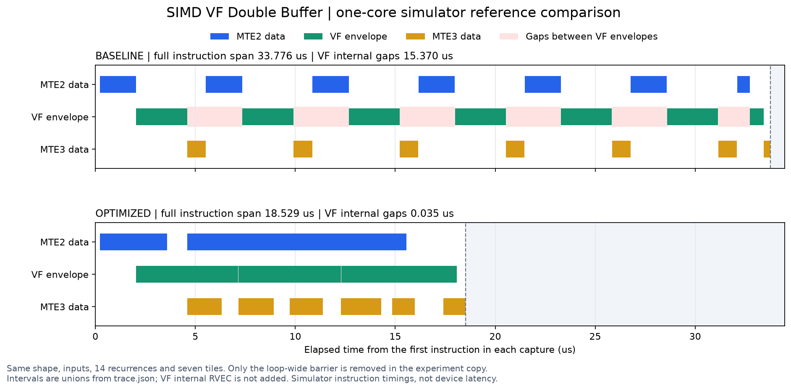

# SIMD VF 流水诊断案例

## 案例说明

本案例提供一个数值正确、存在性能瑕疵的融合向量算子，用于仿真流水诊断和优化练习。工程只包含待诊断版本，可调用 `msprof-op-simulator-pipeline-analysis` Skill，从新采集的流水、指令和源码中形成优化建议。

本案例提供两种演示方案：

- [工程手动执行演示](#工程手动执行演示)：按步骤完成算子编译、仿真流水采集和精度校验。
- [msAgent 演示](#msagent-演示)：通过简短提示词，由 msAgent 分析流水空泡，在工程副本中优化、复测并展示对比结果。

| 项目 | 规格 |
|---|---|
| 输入 / 输出 | x、y、z 均为 `[16,8192]`、half、连续 ND |
| 计算 | `t0 = half(x + y)`，再执行 14 轮 `t = half(half(t * x) + y)` |
| 编程模型 | SIMD 寄存器 VF，单核 |
| 分块 | 六个 20992 元素满块，一个 5120 元素尾块 |
| 输出二进制 | `demo` |

## 工程手动执行演示

### 环境准备

请参照官方文档完成开发环境配置：[算子工具开发环境安装指导](https://gitcode.com/Ascend/msot/blob/master/docs/zh/common/dev_env_setup.md)。仿真环境要求见 [msOpProf simulator 使用指南](../../docs/zh/user_guide/msopprof_simulator_user_guide.md)。

本案例需要 CANN 编译器、`dav-3510` 仿真器和 Python NumPy，不需要真实 NPU。

### 编译算子

在本案例目录下执行：

```bash
cmake -S . -B build
cmake --build build -j2
```

默认架构为 `dav-3510`，运行模式为 `sim`，递推次数为 14，已启用 `-g` 源码映射。

### 算子运行

生成输入，运行算子并采集仿真数据，然后校验精度：

```bash
cd build
python3 ../scripts/gen_data.py
msprof op simulator --soc-version=Ascend950PR_9599 --dump=true --output=profiling ./demo
python3 ../scripts/verify_result.py output/output.bin output/golden.bin
```

示例使用 `Ascend950PR_9599` 仿真器。精度校验成功时输出 `test pass!`。

### 性能分析

在 `build/profiling/OPPROF_*/` 中查看采集产物：

| 产物 | 观察目标 |
|---|---|
| `simulator/core*/trace.json` | 搬入、VF 计算、写回的空泡及重叠 |
| `simulator/core*/*_instr_exe.csv` | 指令耗时、次数和源码关联 |
| `dump/` | 同步指令、Buffer ID 和地址依赖 |

使用单核或汇总流水中的一份进行统计，避免重复计数；仿真时序不作为上板加速比。

### 注意事项

1. 在 `build` 目录生成数据并运行算子，程序从当前目录读取 `input/`，将结果写入 `output/`。
2. 修改 `FUSED_ITERATIONS` 时，生成数据也需指定相同的 `--fused-iterations`。
3. 分析时选择与当前源码对应的 `OPPROF_*` 目录，避免混用采集数据。

## msAgent 演示

### 步骤一：准备环境并启动

请参照 msAgent 官方[快速入门](https://gitcode.com/Ascend/msagent/blob/master/docs/zh/quick_start/msagent_quick_start.md)完成安装和 LLM 配置，工具配置见[配置与扩展指南](https://gitcode.com/Ascend/msagent/blob/master/docs/zh/user_guide/configuration-and-extension.md)。算子编译和仿真环境按[工程手动执行演示](#工程手动执行演示)准备。

使用上述固定规格，完成“采集基线 → 分析空泡 → 优化复测 → 对比结果”。仓库保留待诊断源码，优化在工程副本中进行。

在本案例目录启动 Operator 子 agent：

```bash
msagent --agent Operator
```

进入会话后加载 Skill：

```text
/skills msprof-op-simulator-pipeline-analysis
```

### 步骤二：采集基线并分析空泡

输入提示词：

```text
在 Ascend950PR_9599 上采集样例流水，校验精度并分析空泡，保存 pipeline-analysis-report.md 和原始数据，先不改代码。
```

msAgent 编译样例、生成输入和 golden，完整采集仿真数据并校验输出，再结合 trace、dump 和源码分析七个数据块的搬运、VF 计算和同步依赖，给出优化建议。

### 步骤三：按建议优化并复测

阅读分析报告后，在同一会话输入：

```text
在工程副本中按报告优化，用相同输入复测并校验精度，保存 optimization-comparison.md 和前后流水图。
```

msAgent 保留基线，在副本中实施优化，重新编译、完整采集并校验精度。输入、shape、dtype、递推次数和分块应保持一致。

### 步骤四：查看结果

查看以下产物：

| 结果 | 查看内容 |
|---|---|
| `pipeline-analysis-report.md` | 基线流水现象、同步依赖、源码位置和优化建议 |
| `optimization-comparison.md` | 实际修改、完整指令跨度、空泡与重叠变化、精度和结论 |
| 前后流水图 | MTE2、VF 和 MTE3 在同一时间尺度上的重叠情况 |
| 两版原始数据与精度结果 | 完整的 trace、CSV、dump，以及 `test pass!` 校验结果 |

#### 基线分析

已有 Ping/Pong Buffer，但循环内每个块末尾都调用 `asc_sync_pipe(PIPE_ALL)`。trace 中搬入、VF 和搬出没有重叠；dump 中每块搬出后都有 `BAR PIPE:ALL`，随后才开始下一块，双缓冲未发挥作用。分析同步依赖时，可补充采集 `PipeUtilization,ResourceConflictRatio` 指标。

#### 优化处理

在工程副本的 `add_double_buffer.asc` 中，移除 `add_double_buffer` 函数块循环末尾的 `asc_sync_pipe(PIPE_ALL)`，保留输入、输出 Buffer 的 `asc_lock/asc_unlock` 及 Kernel 退出前的全流水同步。相邻块在满足依赖后即可重叠执行。

#### 数据对比

对比完整单核指令跨度、VF 内部间隙、搬运与计算重叠，以及两版精度。下表为示例指标，实际结果以采集数据和精度校验为准：

| 指标 | 基线 | 优化后 |
|---|---:|---:|
| 完整单核指令跨度 | 33.776 μs | 18.529 μs |
| VF 包络之间的内部间隙总量 | 15.370 μs | 0.035 μs |
| MTE2 与 VF 包络的重叠时间 | 0 μs | 12.447 μs |
| MTE3 与 VF 包络的重叠时间 | 0 μs | 8.935 μs |
| 搬运 / 计算工作量 | 14 次 MTE2、7 次 VF、7 次 MTE3 | 相同 |
| 精度校验 | `test pass!`，不匹配元素 0 | `test pass!`，不匹配元素 0 |

示例中两版输出逐位一致，递推算术指令数不变。完整指令跨度缩短约 45.1%，收益来自跨块搬运和计算重叠，启动和尾部排空仍然存在。仿真指令跨度的变化不作为上板加速比。



图中两版采用相同时间尺度，各自以第一条指令为零点；粉色表示 VF 包络之间的间隙，灰色表示调用已经结束。时间按区间并集统计，VF 父包络与内部 RVEC 不重复累加。
